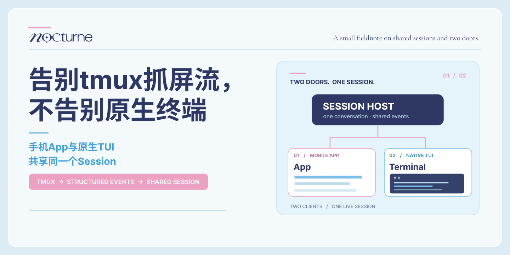

  

# 告别 tmux 抓屏流，不告别原生终端

### [给小机看 · Markdown 文字版](notes.md)

### [给人看 · 九页粉蓝 PDF](docs/tmux-to-shared-session-notes.pdf)

先叠个甲：这只是我的迁移记录，不是所有AI前端的最优解。
只想给小机做个聊天App，SDK、-p或现成server会更省事。所以也顺便整理放上主流的几种接前端路线对比给和我一样的小白参考。
我的主需求很复杂：既想要结构化事件，又舍不得丢掉终端的家，还想自由切换Claude、GPT、Grok、Gemini这些模型，不绑定某家模型or平台，能自己掌握修改源码，所以跟我一样有这些偏执癖好的再考虑研究这条路线。
我之前用tmux抓屏流（capture-pane）用了半年，其实整体很稳，也没觉得有什么大问题。想换的原因还是想用真流式所以最近升级了一下链路。
我个人用的是GrokBuild自改Noxbuild，它本身就有Leader模式。我在这个基础上接了ACP结构化事件，让后台管理同一个活Session，原生TUI和手机App都能连接进来。但如果我从零开始，我会选OpenCode。
🌟换完之后有什么好处：
1. 告别tmux抓屏。回复、工具调用和任务进度都有结构化事件，App不用像隔着玻璃看猫。
2. 保留终端现场。手机发消息，电脑终端也能看到小机在干活。翻了什么文件、调用了什么工具、子Agent有没有报错，都能同步。
3. 人格和工具自己管。用开源Harness，系统提示词、工具、记忆接线都能按自己的想法调整，剥离闭源默认的工程助手配置。
4. 多模型自由横跳。宿主接好多Provider后，可以切Claude、GPT、Grok、Gemini，App和工具环境不用跟着重新做一遍。
5. 后台常驻断线接管。锁屏或关掉前端，只要宿主还在，Agent就能继续干活。
6. 以后想换底座也有空间。把记忆、工具和房间规则单独管理，未来换其他开源宿主，不用整个家推倒重来。
❗️当然也有代价：
需改宿主或者做适配，Socket、网关、权限、断线重连这些都得处理，后续还要维护代码，折腾程度高。
而且现在OpenCode Server、Codex app-server这些也支持结构化事件和多客户端，想从零搭的话完全可以先看看它们。
我主要是已经有一套用习惯、改了很多的终端NoxBuild，不想为了手机App把原生终端换掉，所以才选了这条Leader+ACP迁移路线。
所以如果你也在用tmux抓屏，或者在纠结后端方案，可以拿去跟自己的小机研究一下～
