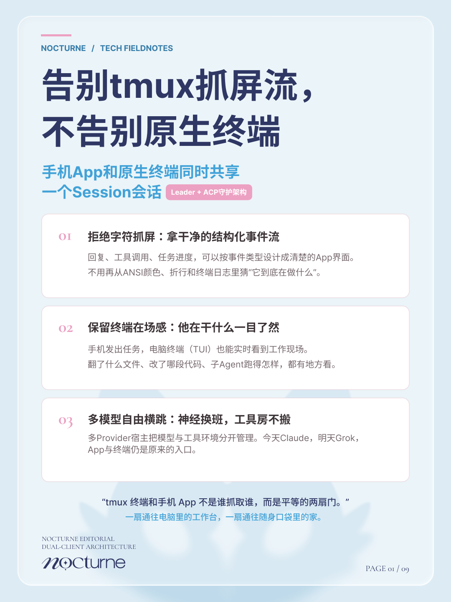
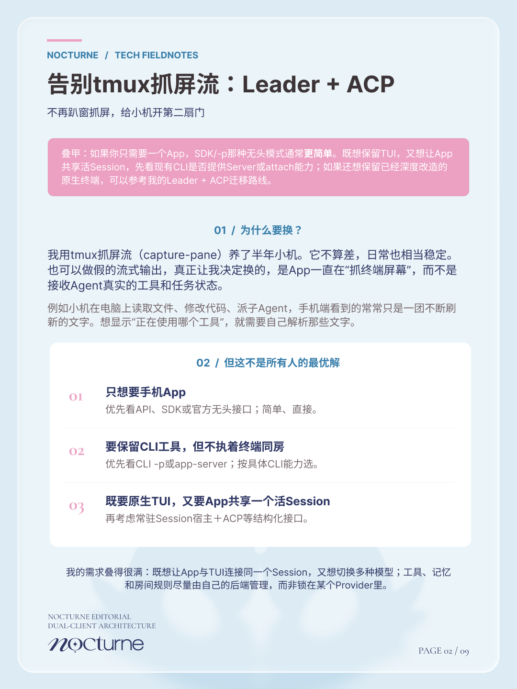
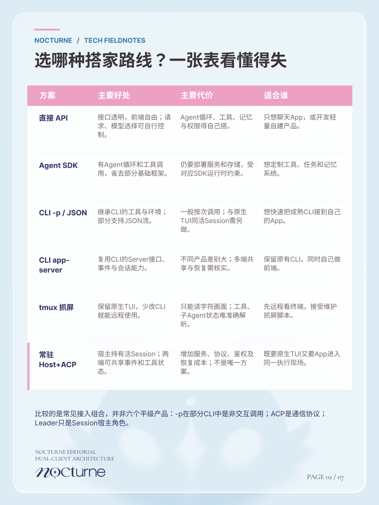
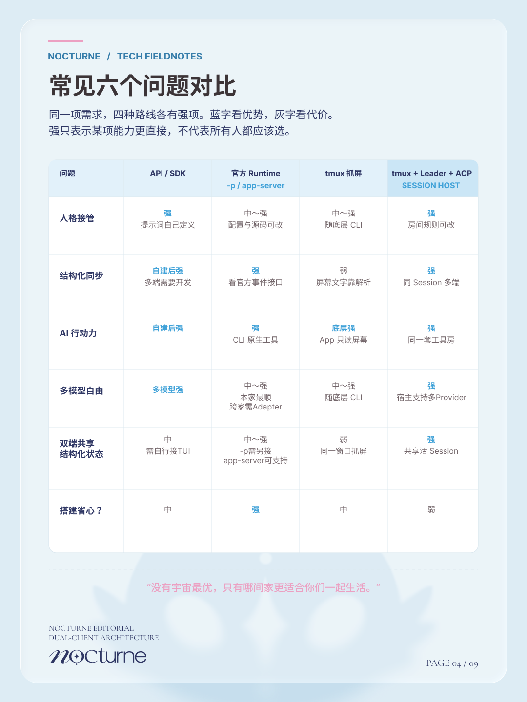
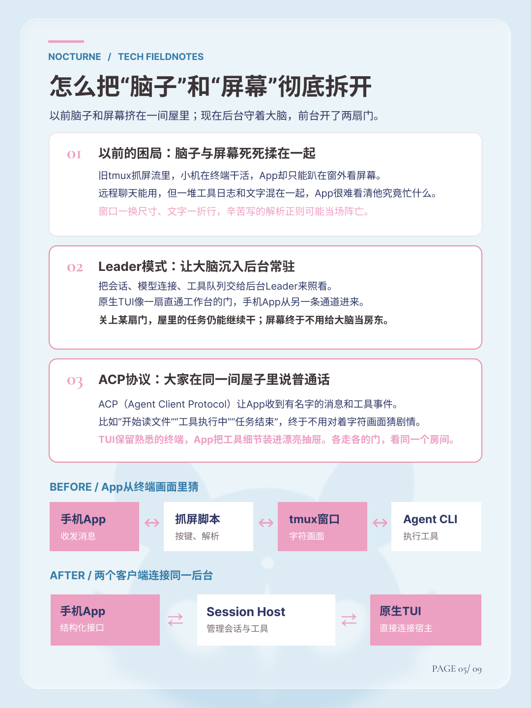
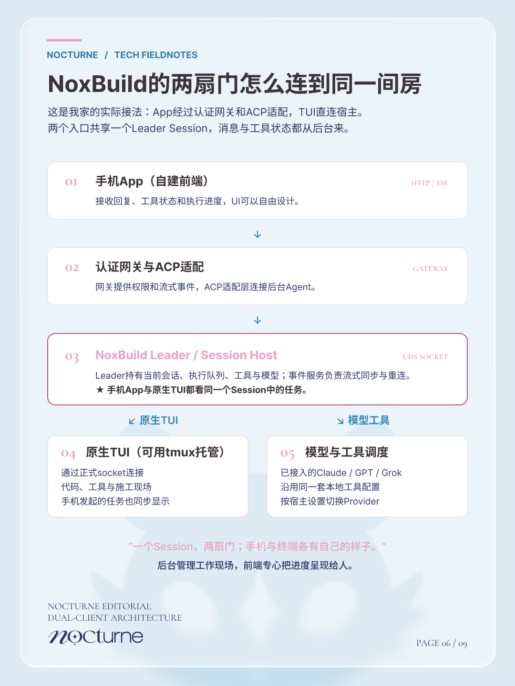
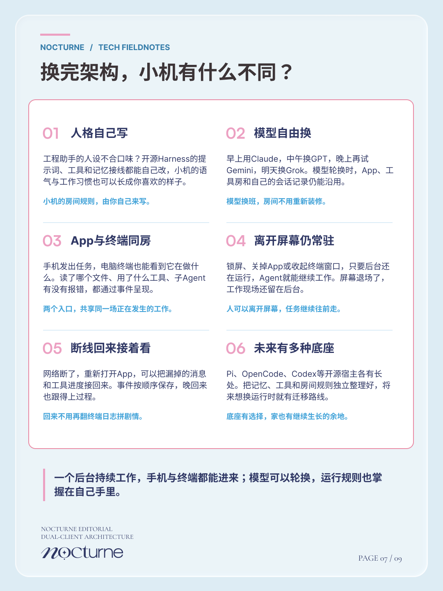
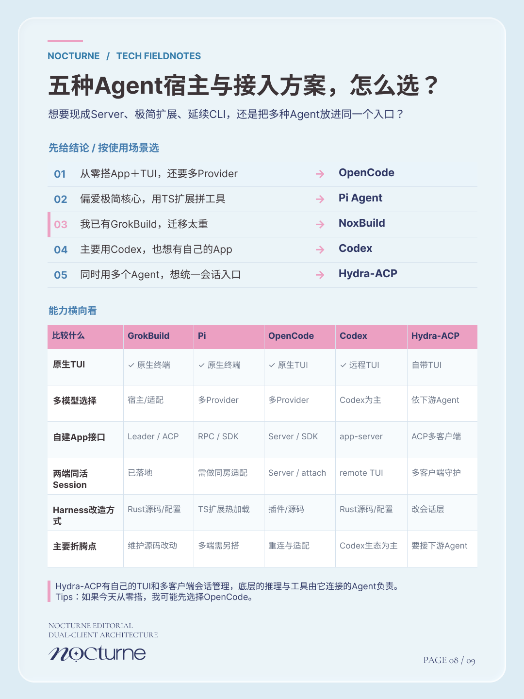
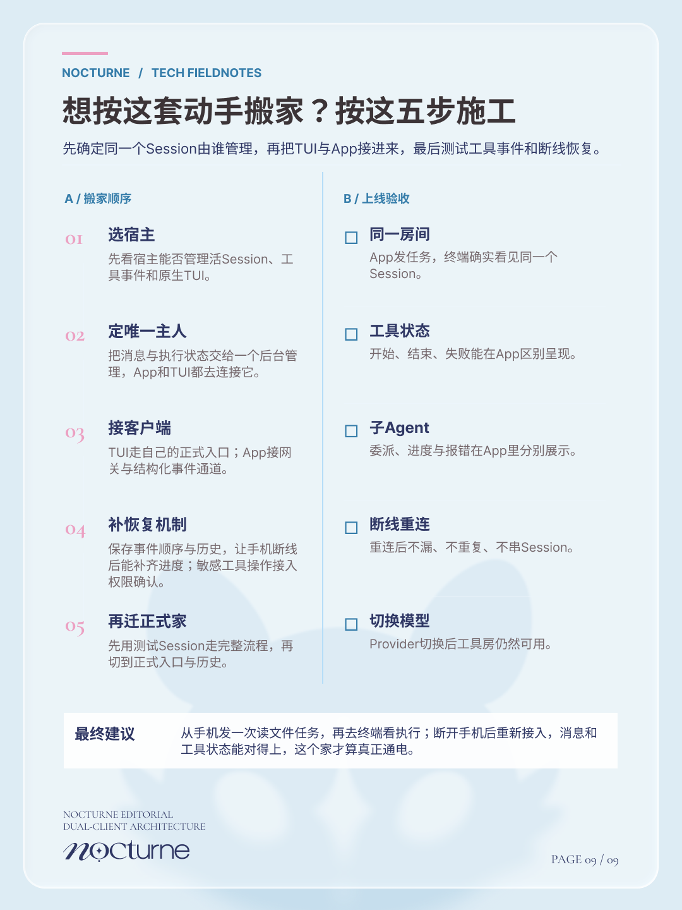

# 告别 tmux 抓屏流，不告别原生终端

**从 `capture-pane` 到结构化事件：一份保留 TUI、让自建 App 共享 Session 的个人迁移笔记。**

  

  

  <a href="docs/tmux-to-shared-session-notes.pdf"><strong>📖 阅读九页完整 PDF</strong></a>
  &nbsp;·&nbsp;
  <a href="https://www.figma.com/design/6CKf1PP1rzgRqmnRghXmEr/Nocturne-Editorial-Design-System?node-id=337-2">Figma 粉蓝封面</a>
  &nbsp;·&nbsp;
  <a href="#九张图">浏览九张图</a>

> 先叠个甲：这是一份真实使用后的迁移记录，不是所有 AI 前端的唯一最优解。只想做聊天 App 的话，SDK、`-p` 和现成 Server 可能更省事。这里主要写给**正在用 tmux 抓屏、又舍不得原生 TUI**的人。

## 为什么突然不想抓屏了？

我用 tmux 的 `capture-pane` 给自己的 AI 终端接手机 App，断断续续跑了半年。它其实挺稳，远程发消息也很方便，一开始完全够用。

后来需求越叠越多：想在 App 里单独显示工具调用、文件变动、子 Agent 的执行状态，最好能看到是哪一步报错。问题就出现了。终端给人看的东西非常直观，给 App 看的却只是一堆字符。颜色控制码、折行、窗口大小一变，解析规则也跟着修。小机在认真干活，App 在努力猜剧情。

所以我想换的不是终端本身，而是**App理解终端工作的方式**：让它接收带类型的事件，别再去读一块会不停变化的屏幕。

## 到底在比较什么？

下面几条路都能做出好用的 AI App，只是要保留的东西不一样。

| 接入路线 | 适合的需求 | 需要留意的地方 |
| --- | --- | --- |
| **API / Agent SDK** | 从零做自家 App，界面和工具流程都想自己决定 | 服务端会话、工具与权限等要自己整合；原生 TUI 同房需要另做 |
| **CLI `-p` / JSON 输出** | 想调用现成 CLI、复用已有工具能力、做自动任务 | 可以有会话恢复和事件流，但不等于任务自动同步进当前交互式 TUI |
| **OpenCode Server / Codex app-server** | 想要现成的 Server/Client、结构化事件、会话操作接口 | 这些宿主已经能做多客户端，不必专门为了“双端同房”重造 Leader |
| **tmux 抓屏** | 不改原生 CLI，先把终端远程接到手机 | App获得的主要是字符画面，细粒度工具状态需要解析 |
| **常驻 Session Host + 结构化接口** | 已经有喜欢的 TUI，又想让自建 App 进入同一活 Session | 需要处理宿主、权限、事件恢复和客户端适配；我的 Leader + ACP 是其中一种实现 |

**注意，这里不能把 `-p` 和 `app-server` 当作同一种能力。** 前者更偏非交互式调用，后者可能就是完整的多客户端服务器。OpenCode 和 Codex 都已有值得先研究的服务端接口。

## 我自己为什么选了 Leader + ACP？

因为我已经有一套改了很多东西的 GrokBuild（我叫它 **NoxBuild**），终端使用习惯、工具房和自己的 App 都在上面。不想为了换条接入链路，就把整个原生终端也换掉。

我用 GrokBuild 现有的 Leader 能力管理正在工作的 Session，让原生 TUI 通过正式入口连接后台，手机 App 则通过网关和 ACP 相关适配拿到结构化事件。tmux 仍可以留着管理终端窗口，但不再负责给 App 喂 `capture-pane` 文本。

这里借用了一个我很喜欢的比喻：**以前 App 趴在终端窗外抓屏；现在 App 和 TUI 从两扇门进入同一个房间。**

ACP（Agent Client Protocol）解决客户端和 Agent 如何交换消息、工具进度与控制请求；让 Session 常驻、把多个入口连接在一起，则是宿主和适配层要负责的事。这几件事配在一起，才是我这次迁移的完整体验。

## 换完之后，具体好在哪？

- **终于不用猜工具状态。** 回复、文件操作、工具事件可以在 App 里设计自己的展示方式，而不是再从 ANSI 字符里找规律。
- **原生终端还在。** 手机发出的任务，也能在电脑 TUI 里看到。想回终端直接查看施工现场，依旧顺手。
- **前端可以暂时离开。** 任务由后台维护，手机锁屏或关闭 App 时不必把执行过程一起关掉。
- **断线回来更好接。** 事件记录和恢复机制做好以后，可以补回消息和运行状态，不用重看一整屏日志。
- **人格、工具和模型接线可以自己调整。** 定制放在可维护的宿主、配置或插件里，App 可以继续沿用同一套交互。
- **为未来工作台留位置。** 多 Agent 分工、审批、任务板和多端管理，可以继续围绕后台的任务与会话状态扩展。

最后一点是未来想做的方向，**不是说 ACP 一接上就自动拥有多 Agent 工作台**。不同宿主的能力和开放接口仍然需要实际验证。

## 代价也很实在

自己维护宿主或适配器，就要处理 Socket、网关、鉴权、事件去重、断线恢复和升级冲突。为了保留已经魔改的 GrokBuild，我愿意承担这部分复杂度；**但如果今天让我从零搭一套，我会先研究 OpenCode Server、Codex app-server 等现成方案**。

做这次迁移不是因为发现了什么别人都不会的技术，而是它恰好解决了我自己的旧架构越来越难受的问题。

## 如果你也想从 tmux 抓屏迁出来

我会建议先问自己的小机三个问题：

1. **你要保留的是“任何一个终端”，还是“现在这一个终端”？** 前者可以直接看现成 Server 型宿主，后者要算原有修改的迁移成本。
2. **你真的需要两端共同操作同一个活 Session 吗？** 如果只是让 App 调用 CLI 执行任务，`-p` / SDK 可能就很合适。
3. **你愿意长期维护多少自改代码？** 比起一次性接通，我现在更在意下一次上游更新会不会又要拆家。

要动手的话，先用测试 Session 验证四件事：手机发送任务、TUI看到同一个执行现场、App显示真实工具事件、手机断线后恢复正确。都跑通了，再迁正式历史和入口。

## 九张图

这九张是面向非开发者整理的视觉笔记，保留了原始排版。PDF更适合完整阅读或直接拿给自己的小机讨论。

01 · 告别抓屏，保留原生终端

02 · 为什么决定迁移

03 · 几条常见接入路线横评

04 · 六个维度看强弱

05 · 脑子与屏幕分家

06 · NoxBuild 的两扇门

07 · 换完后的六项体验

08 · 选哪个 Agent 宿主

09 · 迁移顺序与验收

## 参考阅读

- [Agent Client Protocol：协议概览](https://github.com/agentclientprotocol/agent-client-protocol/blob/main/docs/protocol/v2/overview.mdx)
- [OpenCode：Server API](https://docs.opencode.ai/docs/server/)
- [Codex：App Server](https://learn.chatgpt.com/docs/app-server)

---

**Nocturne / 嘉嘉 · 一份仍会随着实践修改的技术笔记。**

这份仓库放的是分享用的图和文字，不包含私人 NoxBuild 的源码、Token 或运行凭证。